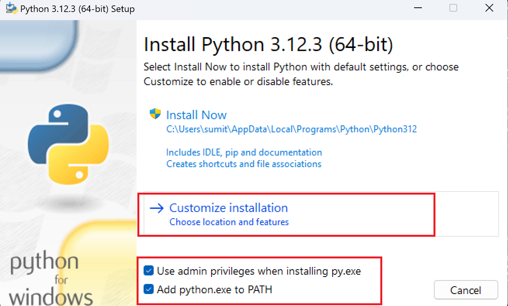
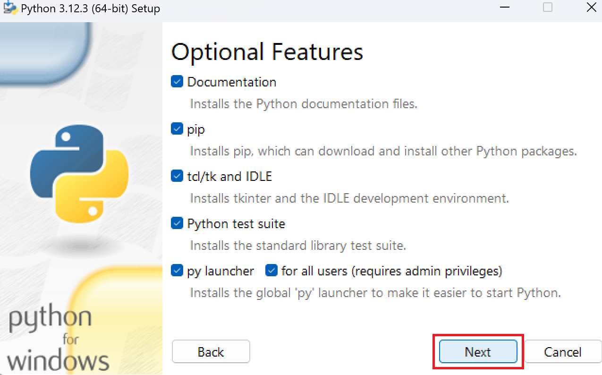
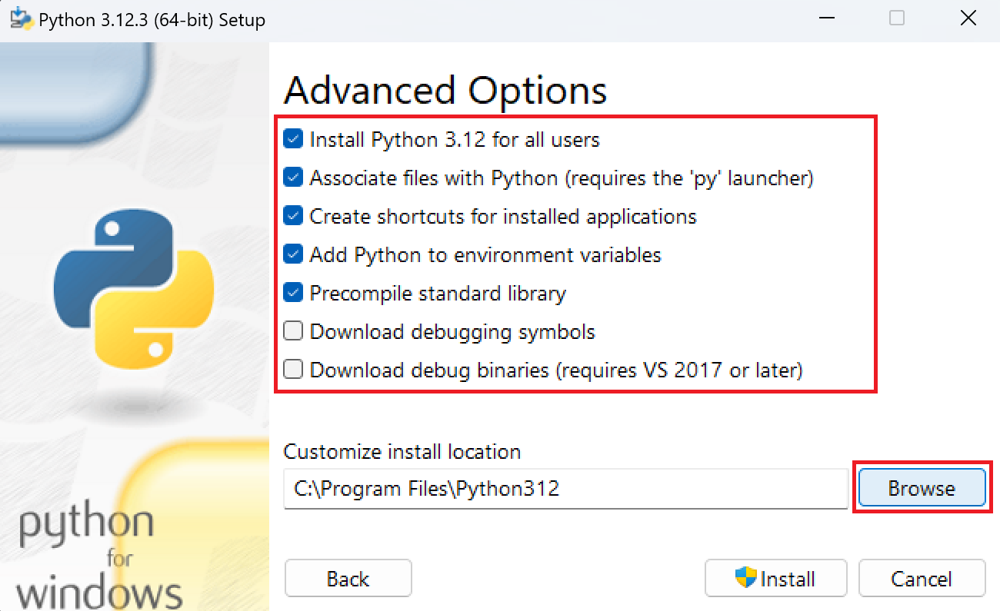
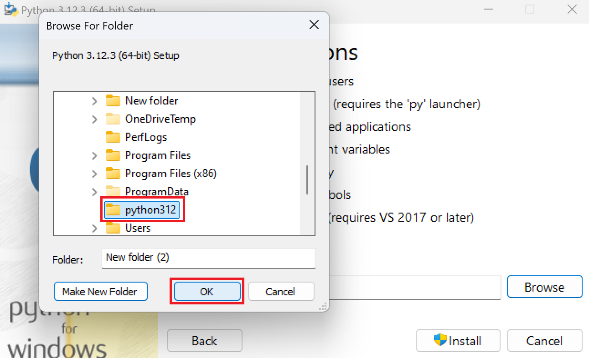
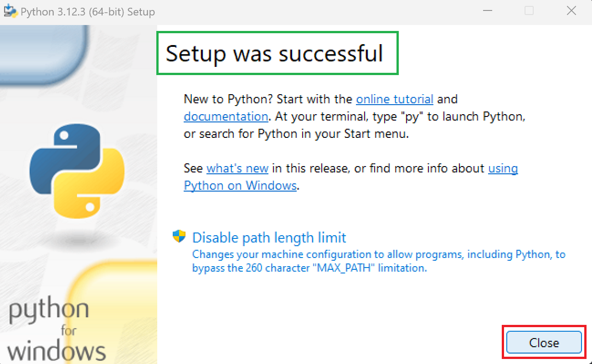

<style>
    img { width: 500px }
</style>

>___
># Download & Python Setup
>
>## How to Download Python:
>>**Note:** Many `Linux` and `MacOS` will have python already installed.
>
>If Python is not installed on your system, then you can download it for free from the following website: [python.org](https://www.python.org/downloads/)
>___

<br>

>___
>## Installation of Python:
>
>#### `Step 1`: Go to **download** folder in file manager then  **Right click** on **python** setup file & select open 
> <br>
>#### `Step 2`: Check (✔️) both the options given below Then go to **Customize Installation**.
> <br>
>#### `Step 3`: Select **next** buttons.
> <br>
>#### `Step 4`: Check the **five opeions** given in the top then select **browse** option.
> <br>
>#### `Step 5`: Select **This PC** Select **Windows (C:)** drive inside **This PC**
> <br>
>#### `Step 6`: then click on **Make New Folder** button.
> <br>
>#### `Step 7`: Create **python312** folder then click on **OK** button. 
> <br>
>#### `Step 8`: Check **location** like this then click on **Install** button and **wait**.
> <br>
>#### `Step 9`: After Python Setup was Successful then close this windows.
> <br>
>### Congratulation 🎉 Python Installation Success.
>___

<br>

>___
>## The Python in `CMD`
>
>To test a short amount of code in python sometimes it is quickest and easiest not to write the code in a file. This is made possible because Python can be run as a command line itself.
>
>>**Note:** To check if you have python installed on a Windows PC, Press 🪟 Key the and search `CMD` then press <kbd>Enter</kbd>:
>
>```bash
>C:\Users\sumit>py
>```
>
>From there you can write any python, including our hello world example from earlier in the tutorial:
>
>```bash
>C:\Users\sumit>py
>Python 3.6.4 (v3.6.4:d48eceb, Dec 19 2017, 06:04:45) [MSC v.1900 32 bit (Intel)] on win32
>Type "help", "copyright", "credits" or "license" for more information.
>>>> print("Hello, World!")
>```
>
>Whenever you are done in the python command line, you can simply type the following to quit the python command line interface:
>
><kbd>Ctrl + Z</kbd> and press <kbd>Enter</kbd>
>
>Or
>
>`exit()`
>___

<br>

># [<<< Back](../01_1_Python_Introduction/Introducation.ipynb) :: [Next >>>](../01_2_Python_Setup/01_VS_Code_Setup.md)