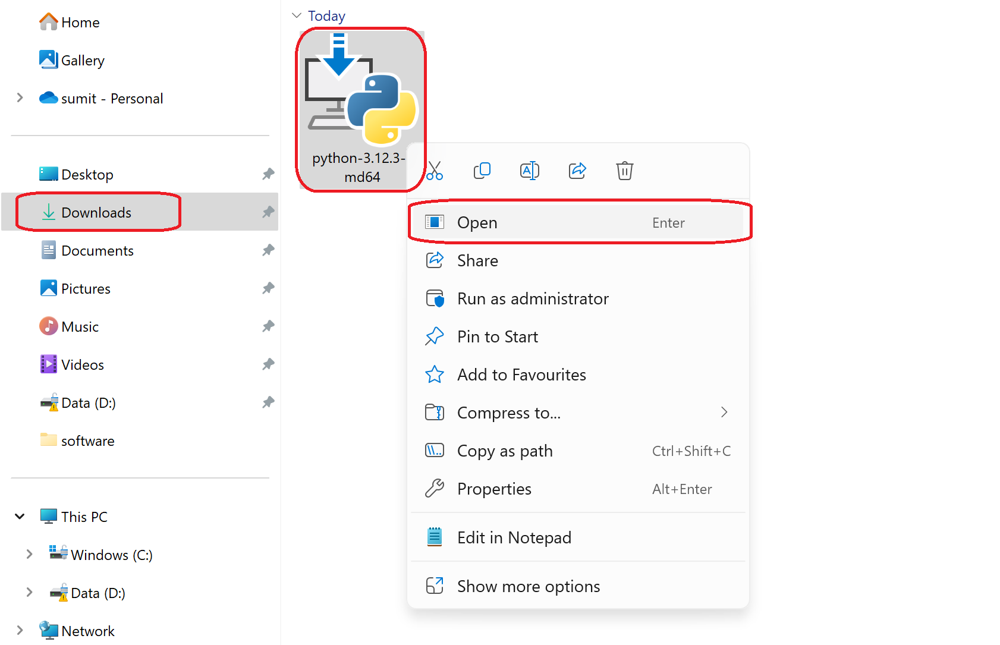
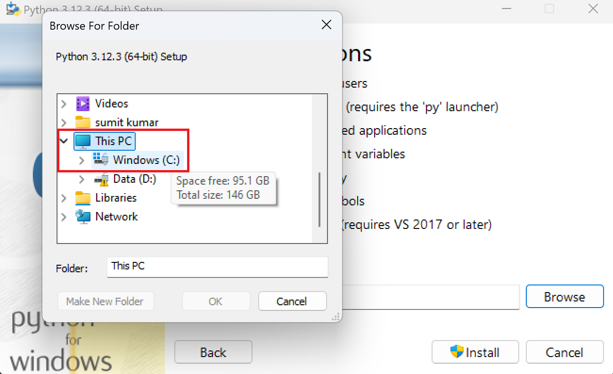
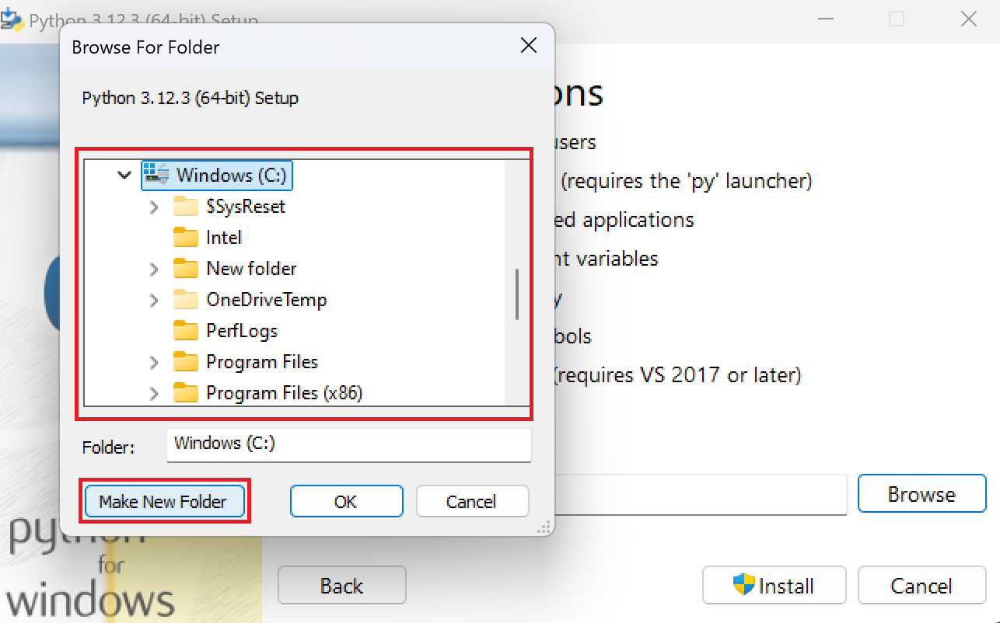
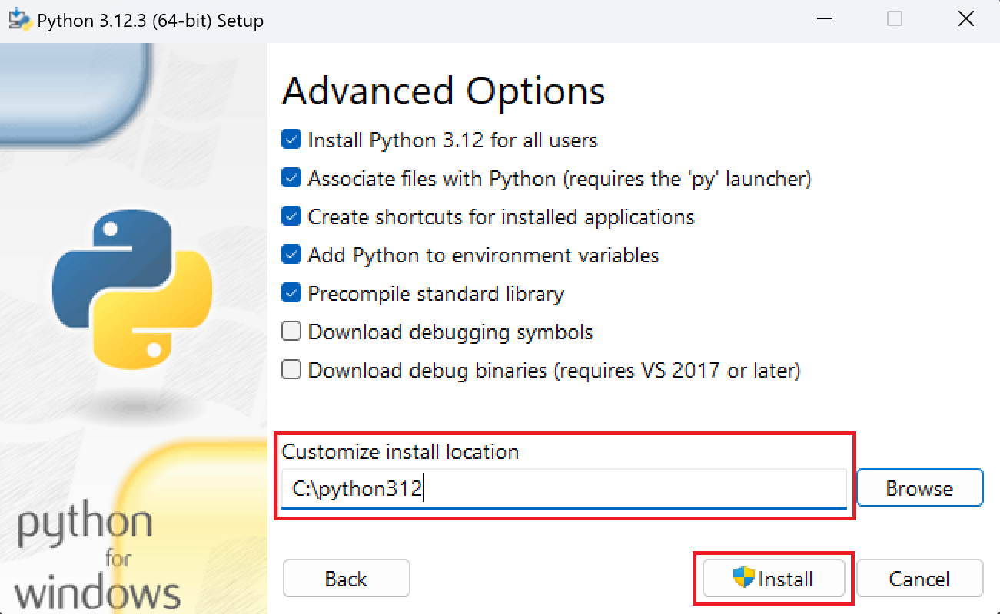

>___
># Download & Python Setup
>
>## How to Download Python:
>>**Note:** Many Linux and Macs OS will have python already installed.
>
>If Python is not installed on your system, then you can download it for free from the following website: [python.org](https://www.python.org/downloads/)
>___

<br>

>___
>## Installation of Python:
>
>### Step 1: Go to `download` folder in file manager 
>
>### Step 2: `Right click` on `python` setup file & select open 
>### Step 3: Check (✔️) both the options given below.
>
>### Step 4: Then go to `Customize Installation` .
>
>
>### Step 5: Select `next` buttons.
>
>### Step 6: Check the `five opeions` given in the top then select `browse` option.
>
>### Step 7: Select `This PC`
>
>### Step 8: Select `Windows (C:)` drive inside `This PC` then click on `Make New Folder` button.
>
>### Step 9: Create `python312` folder then click on `OK` button.
>
>### Step 10: Check `location` like this then click on `Install` button and `wait`.
>
>### Congratulation 🎉 Python Installation Success.
>___

<br>

>___
>## The Python in `CMD`
>
>To test a short amount of code in python sometimes it is quickest and easiest not to write the code in a file. This is made possible because Python can be run as a command line itself.
>
>>**Note:** To check if you have python installed on a Windows PC, Press 🪟 Key the and search `CMD` then press <kbd>Enter</kbd>:
>
>```bash
>C:\Users\sumit>python --version
>```
>
>
>Or, if the "python" command did not work, you can try "py":
>
>```bash
>C:\Users\sumit>py
>```
>
>From there you can write any python, including our hello world example from earlier in the tutorial:
>
>```bash
>C:\Users\sumit>python
>Python 3.6.4 (v3.6.4:d48eceb, Dec 19 2017, 06:04:45) [MSC v.1900 32 bit (Intel)] on win32
>Type "help", "copyright", "credits" or "license" for more information.
>>>> print("Hello, World!")
>```
>
>Whenever you are done in the python command line, you can simply type the following to quit the python command line interface:
>
><kbd>Ctrl + Z</kbd> and press <kbd>Enter</kbd>
>
>Or
>
>`exit()`
>___

<br>

># [<<< Back](../01_Intro/Introducation.md) :: [Next >>>](../03_Syntax/Syntax.ipynb)