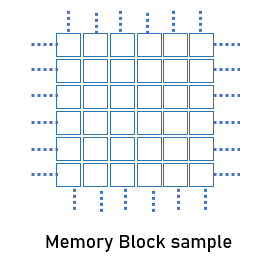
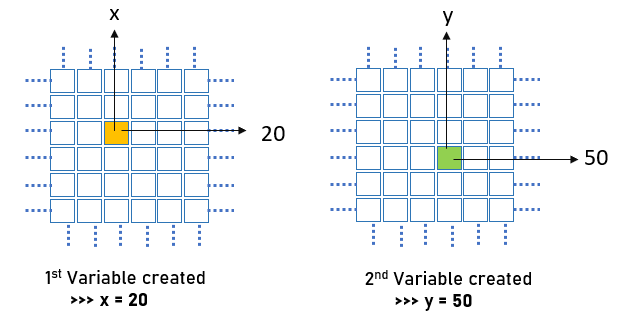
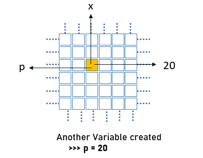
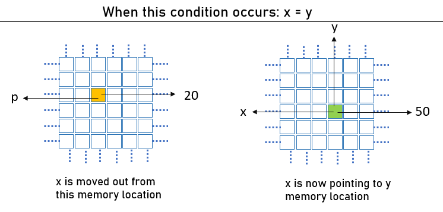
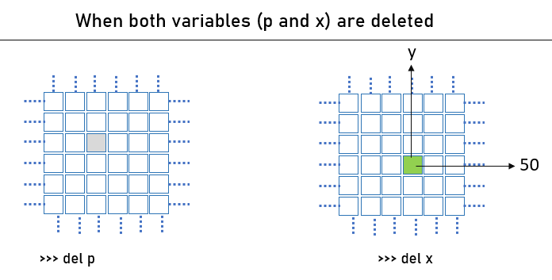

>___
># Python Variables
>
>Variables are containers for `storing data` values.
>
>Variable names are `case-sensitive`.
>
>### Create Variable
>
>For example, to create a variable name **Student** to hold **student's name** and variable **age** to hold **student's age**
>
>```py
>student = 'Amit'
>age = 18
>```
>
>| variable  |  Value |
>| --------  |  ----- |
>| student   | 'Amit' |
>| age       |  18    |
>
>Variables do not need to be declared with any particular type, and can even change type after they have been set.
>___
>


>___
># Create Variable
>
>Python has no command for declaring a variable.
>
>A variable can have a short name (like x and y) or a more descriptive name (age, carname, total_volume). 
>
>**Rules:** for Python variables:
>
>- A variable name must `start` with a `letter (A)` or the `underscore (_)` character
>- A variable name `cannot` start with a `number`
>- A variable name can only contain `alpha-numeric` characters and underscores `(A-z, 0-9, and _ )`
>- Variable names are `case-sensitive` (age, Age and AGE are three different variables)
>- A variable name `cannot` be any of the Python `keywords`.
>___

>___
>### Reserve keyword in Python
>Python does not permit the use of some words for naming the variable. These words are reserved by python programming language hence known as Reserved Keywords. Complete list of python reserved keywords is given below.
>
>>```py
>>help("keywords") # run in python cmd
>>```
>
>```py
>False               class               from                or
>None                continue            global              pass
>True                def                 if                  raise
>and                 del                 import              return
>as                  elif                in                  try
>assert              else                is                  while
>async               except              lambda              with
>await               finally             nonlocal            yield
>break               for                 not
>```
>___

>___
>### Legal variable names ✅
>>```py
>># variable = value
>>myname = "Sumit"
>>my_name = "Sumit"
>>_my_name = "Sumit"
>>myName = "Sumit"
>>MYNAME = "Sumit"
>>myname2 = "Sumit"
>>```
>
>### Illegal variable names ❎:
>>```py
>>2myname = "Sumit"
>>my-name = "Sumit"
>>my name = "Sumit"
>>@my_name = "Sumit"
>>&my_name = "Sumit"
>>```
>___


>___
># Multi Words Variable Names
>Variable names with more than one word can be difficult to read.
>like this: `myvariablename`
>
>There are several techniques you can use to make them more readable:
>
>### Camel Case
>Each word, except the first, starts with a capital letter:
>
>```py
>myVariableName = "Sumit Kumar"
>```
>
>### Pascal Case
>Each word starts with a capital letter:
>
>```py
>MyVariableName = "Sumit Kumar"
>```
>
>### Snake Case
>Each word is separated by an underscore character:
>```py
>my_variable_name = "Sumit Kumar"
>```
>___


>___
>### Python Variables memory references
>
>When a variable is declared and initialized in python, it will allocate memory and hold the value. This memory (along with the value) will be referenced by a variable name. Python variable is a symbolic name which is referencing to a memory.
>
>This is a sample memory block used by Python.
>
>
>___

<br>

>___
>Let us understand by looking at the pictorial example,
>
>After executing the following code in python,
>
>```py
>x = 20
>y = 50
>```
>
>Two objects are created in memory which is holding the individual value.
>
>
>
>python memory with the variable
>___


>___
>Now suppose another variable ‘p’ is created with the same value as of ‘x’, this will not create a new memory instead it will reference the memory of x with one more pointer named ‘p’.
>
>```py
>p = 20
>```
>
>
>___


>___
>two equal variables in python
>
>two-variable sharing same memory
>
>When the below statement is executed,
>
>
>```py
>x = y
>```
>
>
>___


>___
>### Deleting Python Variables
>In Python, a declared variable can be deleted at any time using a del keyword. Once the variable is deleted it can not be used further in the program.
>```py
>del x
>```
>In the end, when both variables (x & p) are deleted using the python program then this memory is no more referenced (by either x or p) and at the same time, no value exists in that memory. At this point of time, the only variable y is referenced to a memory holding the value of 50.
>
>
>___
